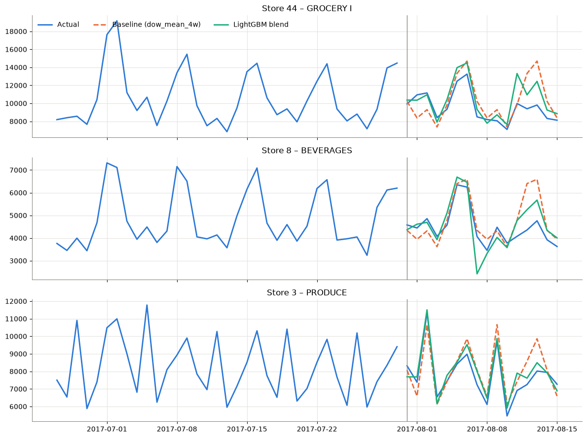
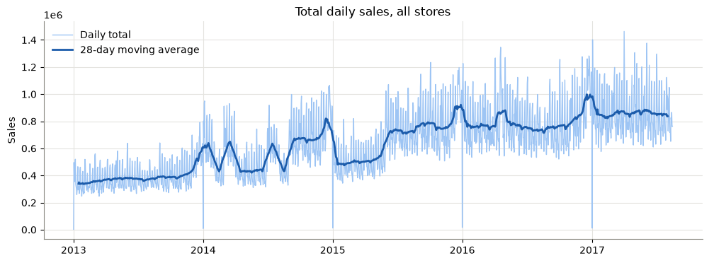
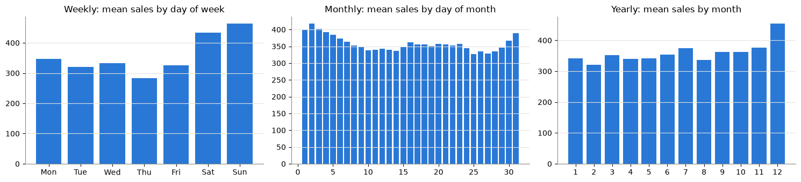

# Store Sales - Time Series Forecasting

My work on the Kaggle competition [Store Sales - Time Series Forecasting](https://www.kaggle.com/competitions/store-sales-time-series-forecasting): forecasting daily sales of Favorita stores (Ecuador) for 54 stores x 33 product families, 16 days ahead. Metric: RMSLE.

## Results

Walk-forward validation on 3 consecutive 16-day windows (RMSLE, lower is better):

| Model | Window 1 | Window 2 | Window 3 | Mean |
|---|---|---|---|---|
| Baseline (mean of last 14 days) | 0.461 | 0.474 | 0.519 | 0.485 |
| LightGBM global | 0.374 | 0.390 | 0.398 | 0.387 |
| LightGBM per family | 0.373 | 0.389 | 0.396 | 0.386 |
| Blend of both | 0.370 | 0.386 | 0.391 | 0.382 |



## What's in the notebook

- EDA: trend, weekly / monthly / yearly seasonality, ACF/PACF, stationarity (ADF), oil price, promotions, holidays
- Baselines: naive, seasonal naive, moving averages
- Features: sales lags (>= 16 days to avoid leakage), rolling and EWM means, calendar, store info, oil, holidays, promotions, store and family level trends
- Models: one global LightGBM + one LightGBM per product family, trained on `log1p(sales)`, averaged at the end




## Run it

```bash
pip install -r requirements.txt
```

Download the data from the [competition page](https://www.kaggle.com/competitions/store-sales-time-series-forecasting/data) into `store-sales-time-series-forecasting/`, then run `ds_experiments.ipynb`. Submissions are saved in `submissions/`.

## Next

- Average a few seeds
- Hyperparameter tuning
- Use transactions as a feature
